# Hocket Lab GitHub SOP

**Basic use and collaboration**

Xiaoping Li

Email: xbl5418\@psu.edu

November 10, 2026

## Table of Contents

[Section 1: Github Basics 2](#section-1-github-basics)

[1.1-What is version control, Git and Github?](#11-what-is-version-control-git-and-github)

[1.2-Basic workflow of Git](#12-basic-workflow-of-git)

[Section 2: Procedures](#section-2-procedures)

[2.1-Location of Hockett Lab github](#21-location-of-hockett-lab-github)

[2.2-Common procedures to set up your project on Hockett Lab github](#22-common-procedures-to-set-up-your-project-on-hockett-lab-github)

[2.3-Special procedures for multiple collaborators](#23-special-procedures-for-multiple-collaborators)

[2.4-Record keeping](#24-record-keeping)

[Section 3: Demonstration](#section-3-demonstration)

[3.1-Steps to push your files from your computer to github repositories](#31-steps-to-push-your-files-from-your-computer-to-github-repositories)

[3.2-A special case with multiple collaborators](#32-a-special-case-with-multiple-collaborators)

## Section 1: Github Basics

1.1-What is version control, Git and Github?
--------------------------------------------

**Version control** is tracking and managing multiple versions of files
and codes or different branches of a project where there are updated
edits have occurred at various stages of the project. Imaging your
manuscript has received feedback from 10 co-authors and you need to
consolidate all their edits and comments into one newer version. This is
version control. Although it is easy (not really) to manage feedback
from 10 people for a manuscript, it would be challenging to manage
hundreds or even thousands of lines of codes from many develops in a
software company. **Git** is a computer program designed for this very
purpose; a version control system. And **Github** is a web-based
platform that allows developers (and researchers, writers, and more!) to
store, manage, and collaborate their projects. Figure 1 shows their
features.

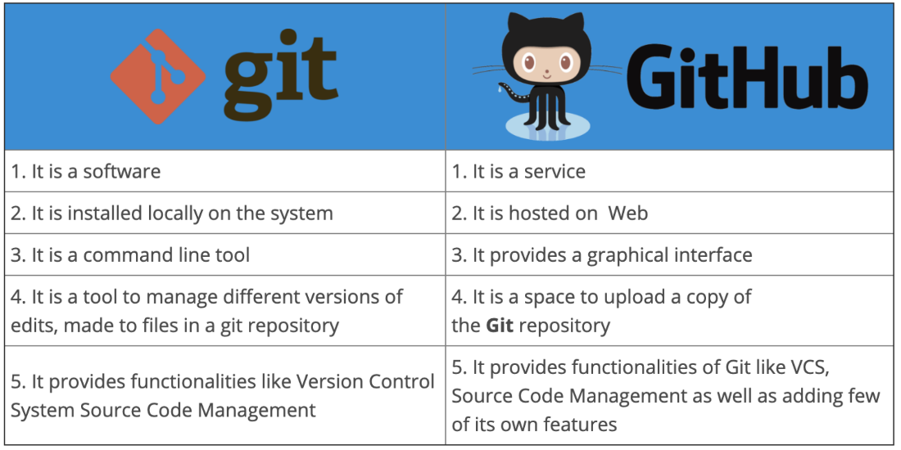{width="5.0in" height="2.5in"}

Figure 1. Comparison between Git and Github.

1.2-Basic workflow of Git
-------------------------

The major steps to upload (push) files from your computer to Github are
described in Figure 2, although it is for command line. A desktop app is
also available to download (see section 2 - procedures).

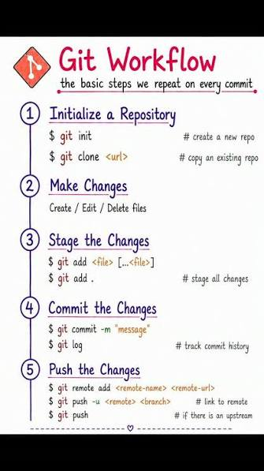{width="3.4895833333333335in" height="6.21875in"}

**Figure 2. Git workflow**

When multiple people are working on a project or you want to experiment
with some new features/changes but you don't want them to mess up the
main project, you will create a branch in which your work won't affect
the main project and other people's work on other branches. In Git, the
main project is called the main or master branch, and it is the default
branch we work on. If you are content with the work on your branch, you
can request for merging the changes you made into the main branch after
reviewing by the team (Figure 3).

{width="6.5in" height="3.328472222222222in"}

Figure 3. Create new branches and merge

## Section 2: Procedures

2.1-Location of Hockett Lab github 
--------------------------------------

Hockett Lab github space is located at
<https://github.com/Hockett-Lab-PennState>

2.2-Common procedures to set up your project on Hockett Lab github
---------------------------------------------------------------------

1)  **You should register an account for Github & download the Github
    desktop at <https://github.com/apps/desktop> **

2)  Request lab manager to create a repository for your project with the
    following standard information:

    a.  Your project name

    b.  Indicate if it is public or private

    c.  Copy right

    d.  Prepare a short description of your project (Note, for a
        manuscript, please provide an abstract of your published work, a
        link to the published work and a link to the website where you
        store your experiment data). This description will be used for
        initiating the Readme file on Github

    e.  Your github username and email used for github

3)  Once your repository is created, the lab manager will send you an
    invitation to collaborate on the repository and the url link to the
    repo.

4)  Accept the invitation, you will have access to pushing your file to
    the project repository.

5)  On your computer, create a folder (where you will put your files for
    uploading, but not yet)

6)  Open your github desktop app, and click the triangle ▼ in the
    **Current repository** box to open up an action panel. You will see
    **Add▼** dropdown button. Select **Clone repository**.

7)  In the pop-up window, select **URL** to input your repository URL
    (address) on the first box. Choose the path for the folder you just
    created. Then click on **Clone**. Cloning a repo will download all
    the files in that repo, you **should not** need to create a repo
    locally using 'git init'.

8)  Now, copy and paste the files you would like to include in the
    folder. You will see those files showed up in the left panel under
    the **Changes** tab.

9)  Still in the left panel, write down summary and a short description
    before committing the push. For example, you could write "First
    commit with all files" in the Description box.

10) Click on **Commit to main** bar in blue below.

11) In the big right panel, you will see a highlighted box asking you to
    **push origin**, click on that button and Github desktop app will be
    uploading all your files to your project repository.

12) You are done! Go to github repo and see if your files are there.

2.3-Special procedures for multiple collaborators
----------------------------------------------------

1)  If a repository has multiple collaborators on the same file, each
    collaborator should create a new branch.

2)  Make sure your current branch box pointing to your branch, not the
    main branch.

3)  Continue to make changes to the file.

4)  Commit the changes to your branch

5)  On the right panel, push the changes in your branch to github by
    clicking **Push branch **

6)  **Now github needs to review your changes before merging to the main
    branch.**

7)  On the right panel, the highlighted box will ask you to preview pull
    request and create pull request. Preview pull request will show you
    the changes to the file. Then you click on ▼ on the button to select
    create pull request, then click on it.

8)  Your request will show on Hockett lab github where your team and the
    manager can review those changes. If everything looks ok without
    conflicts then the manager can approve the changes and merged the
    files to the main branch.

2.4-Record keeping
--------------------

The lab manager should prepare an excel file that keeps a record of all
lab members' repositories, including project name, author, date of
creation, and a link to the project.

It is also a good idea to keep shared lab files in other repositories.
For example, all lab protocols can be placed in the lab protocol
repository where new lab members can find them in addition to OneDrive.
Lab protocol repository is set to private so only lab members can review
them.

## Section 3: Demonstration

3.1-Steps to push your files from your computer to github repositories
----------------------------------------------------------------------

1.  Go to <https://github.com/> and register an account; download and
    install Github desktop <https://github.com/apps/desktop>

2.  Send lab manager an email with information detailed in section 2
    part 2 (2.2.2)

3.  You will receive collaboration invite on Github (with email
    notification) after the lab manager created your repository, see
    below:

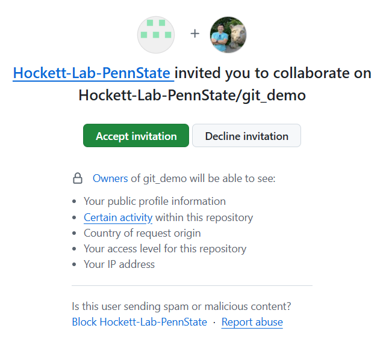{width="3.5107666229221346in"
height="3.13043416447944in"}

4.  Accept the invitation so you will have access to upload your files
    to the repo.

5.  Create a folder where you will put your files for uploading to the
    repo on your computer.

6.  Open Github Desktop App and click on the triangle in Current
    repository box (see below) and click on the add button (see below)
    to choose clone the repository. {width="3.25in"
    height="0.7083333333333334in"}

{width="3.1041666666666665in"
height="0.4895833333333333in"}

7.  In the pop-up box, copy and paste the URL of your github repo and
    the path to the folder you just created in Step 5. Then click on
    Clone button, which will download the repo from github to the folder
    just created.

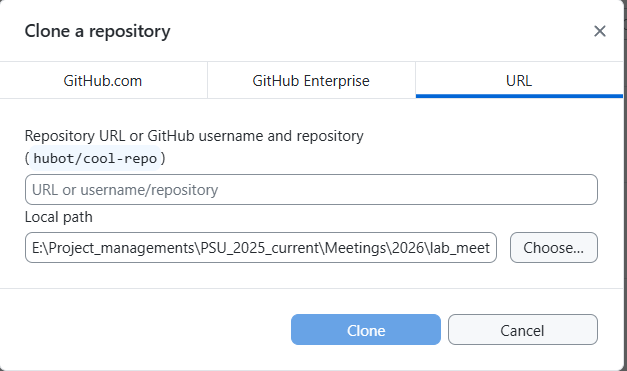{width="6.5in" height="3.845833333333333in"}

8.  Copy and paste your files to the folder, or create or make any
    changes in any files will be tracked by Git and seen in the left
    panel of Github Desktop under the 'Changes' panel. See below
    example: I created a file named Git\_demo\_example1.txt to the
    folder and wrote a line of description in it. Github desktop tracks
    those changes highlighted in green.

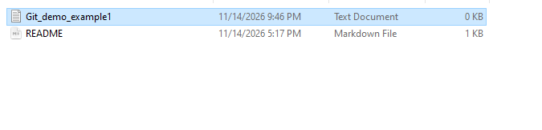{width="4.843478783902012in"
height="1.1622276902887139in"}

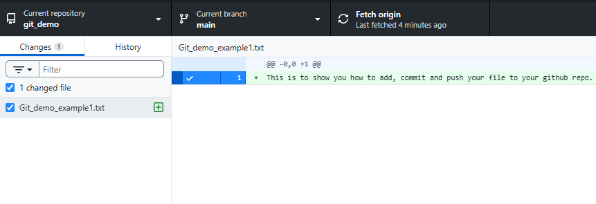{width="6.5in" height="2.2270833333333333in"}

9.  Once you are done with any modifications on the files, write a short
    description in the commit message box (see below), then click on
    Commit 1 file to main. The main means the main branch, which is
    default workplace, refer to Figure 3 in section 1.

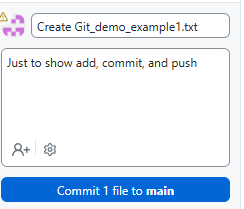{width="2.5416666666666665in"
height="2.1770833333333335in"}

10. Now all files are ready to be pushed (in another word, uploaded) to
    your project repo on github. So click on 'push origin' button on the
    desktop app (see below).

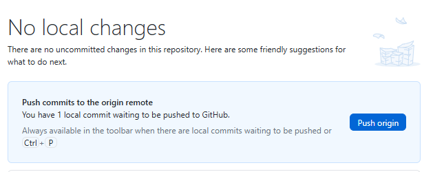{width="4.673912948381452in"
height="1.8116404199475065in"}

11. After uploading, you will see the Git\_demo\_example1.txt appear in
    the project repository on the Github (see below).

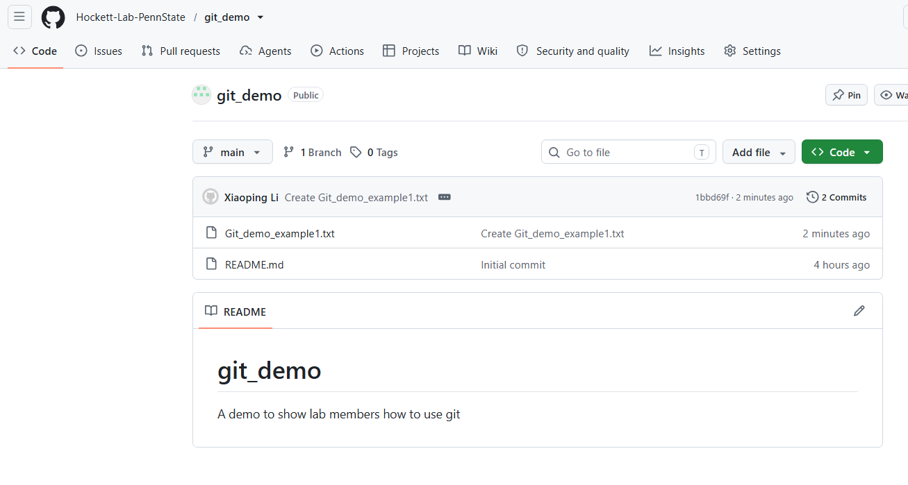{width="6.470982064741907in"
height="3.4608694225721783in"}

3.2-A special case with multiple collaborators 
-----------------------------------------------

1.  **Each collaborator making changes of the files of the project needs
    to create their own branch** (I recommend use collaborators'
    initials or purpose for branch name. For example: Xiaoping\_branch).

2.  To create a new branch, click on the Current branch box and the new
    branch button see below. Your branch is recommended based on the
    main.

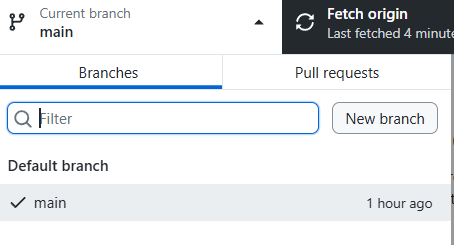{width="4.729166666666667in"
height="2.5520833333333335in"}

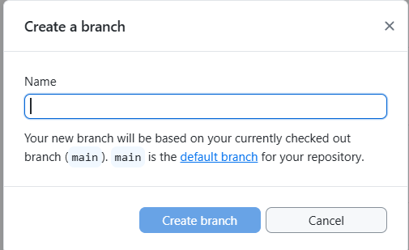{width="4.164764873140857in"
height="2.5483409886264217in"}

3.  As a collaborator, I now added a line to the
    'Git\_demo\_example1.txt' file. These changes are tracked by Git.

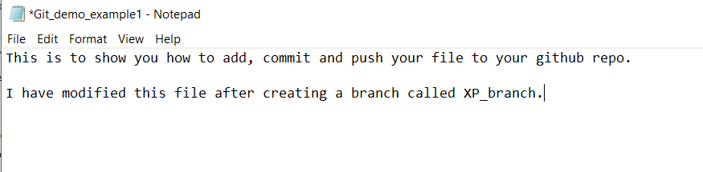{width="5.612607174103237in"
height="1.3791666666666667in"}

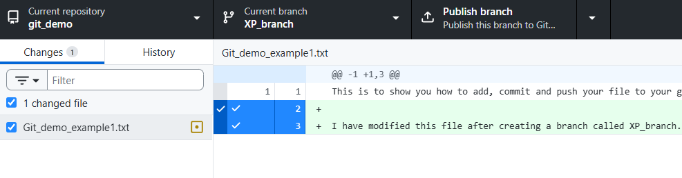{width="5.2652176290463695in"
height="1.3764938757655294in"}

4.  Write a short description in the commit message box see below.

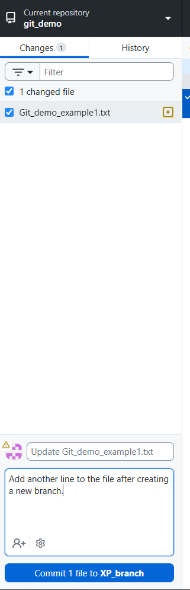{width="1.58498687664042in"
height="4.9130435258092735in"}

5.  Now we are ready to push the branch and the changes of the files to
    github repo. So click on Publish branch

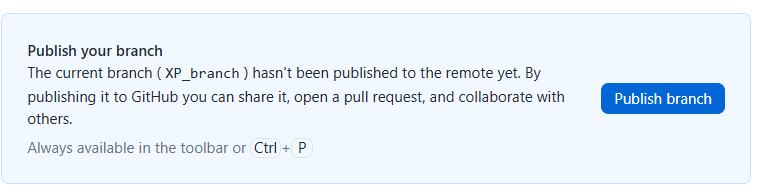{width="6.5in" height="1.5909722222222222in"}

6.  These changes at your branch need to be reviewed by lab manager
    (called pull request) or your team before merging your changes to
    the files on the main branch. So, check the changes once again by
    clicking on 'Preview Pull Request' (see below). Or if you are sure
    the changes are ok, click on the triangle dropdown menu and select
    create Pull Request, click on that button after selection.

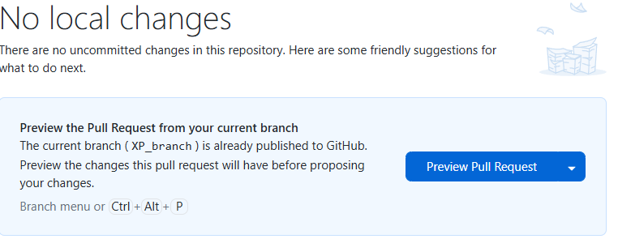{width="4.526087051618548in"
height="1.7524081364829396in"}

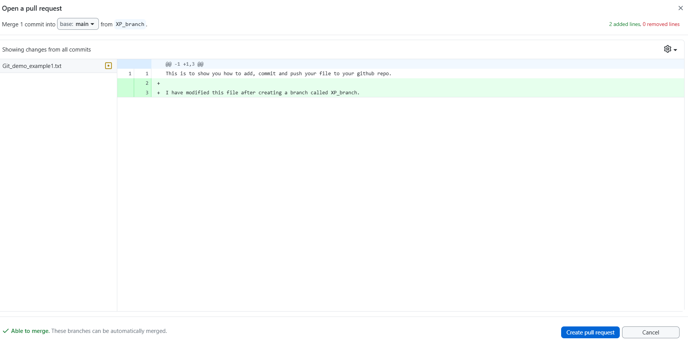{width="4.369564741907261in"
height="2.1931856955380575in"}

7.  The lab manage or your team can review those changes on the project
    repository and lab manage can approve your request and merge your
    changes in the files, which will update the files in the main
    project (like consolidating all comments and edits from your
    co-authors into a clean version of manuscript). Now you are done!

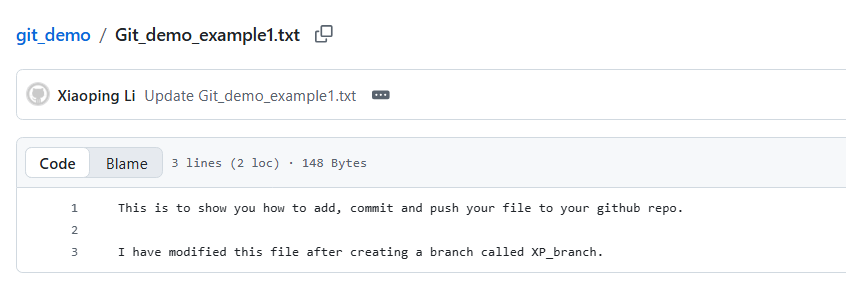{width="6.5in" height="2.3513888888888888in"}

**If you have any questions, please contact** Xiaoping **at
<xbl5418@psu.edu> . Fun fact: The mascot of github is a cat-octopus,
named Mona the Octocat.**

{width="5.875in" height="3.3125in"}

